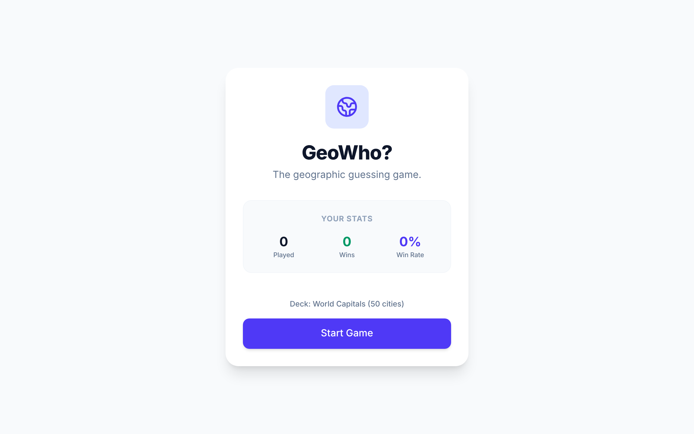
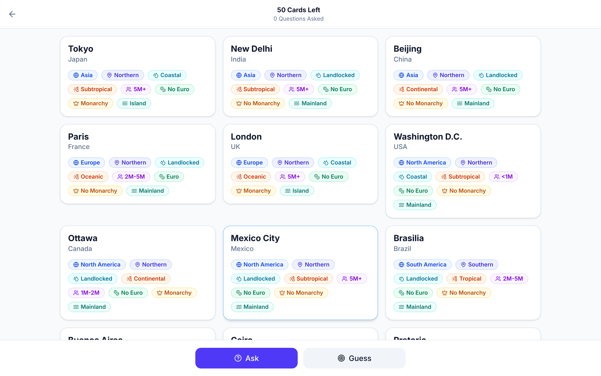

# GeoWho?

A "Guess Who"-style geography game where the app picks a secret world capital city
and the player must identify it by asking yes/no questions.

Built as a 4th Semester capstone project at George Brown College.

<p>
  
  &nbsp;
  
</p>

## Highlights

- 50 world capitals, each tagged by continent, hemisphere, coastline, climate, population, currency, government and island or mainland
- Asking a question filters the board automatically, so the player sees the effect of every answer
- Game state lives in one Zustand store, and win/loss stats persist in `localStorage`
- Card layout animates with Framer Motion as cards are ruled out

## How to Play

1. Press **Start Game** — the app picks a secret capital city
2. Press **Ask** to ask a yes/no question (e.g. "Is it in Europe?", "Is it coastal?")
3. Cards that don't match the answer are greyed out automatically
4. Press **Guess** when you think you know the answer — tap the card to guess
5. Win by guessing correctly, lose by guessing wrong

## Tech Stack

- React 19 + TypeScript
- Vite
- Tailwind CSS
- Zustand (state management)
- React Router
- Framer Motion (animations)

## Run Locally

**Prerequisites:** Node.js

1. Install dependencies:
   ```
   npm install
   ```
2. Start the development server:
   ```
   npm run dev
   ```
3. Open your browser at `http://localhost:3000`

## Project structure

```
src/
  screens/     Start, Game and Result screens
  components/  Game board, question modal, question log, action bar
  store/       Zustand game store
  data/        Cities and decks
  utils/       Question-matching logic
```

## What I'd add next

- More decks, such as US states or European countries
- Unit tests for the question-matching logic
- Deploy a public demo

